  <picture>
    <source media="(max-width: 640px)" srcset="./assets/profile-banner-mobile.svg" />
    
  </picture>

  &nbsp;
  &nbsp;
  

## What I do

I’m a Senior Software Engineer in data engineering at Capgemini, working on ETL and data integration. That covers everything from keeping scheduled loads healthy to designing SCD Type 1/2, file-processing and hierarchy-parsing pipelines. My everyday stack is Informatica IICS/IDMC, PowerCenter, SSIS, Azure Synapse, Oracle, DB2 and SQL.

After hours I build browser-based data tools and Python services, including a document Q&A system using FastAPI, LangChain, RAG and FAISS.

## Things I’ve built

The cards below link to live demos and source. The document Q&A system below them is source available, with local setup instructions.

<table>
  <tr>
    <td width="50%" valign="top">
      
      
A Python data-quality toolkit for CSV, Excel and API feeds. Pydantic validation, rejected-row reports, transactional MySQL loads, SCD Type 2 history and safe batch retries. The browser demo runs the same validator through Pyodide.  See the repository’s CI and release notes for current test and compatibility results.

      
Python, Pydantic, SQLAlchemy, MySQL, Pytest, Pyodide

      
<a href="https://theraghavraman.github.io/etl-validation-toolkit/">Try the demo</a> &nbsp;|&nbsp; <a href="https://github.com/theraghavraman/etl-validation-toolkit">Source</a> &nbsp;|&nbsp; <a href="https://github.com/theraghavraman/etl-validation-toolkit/releases/latest">Latest release</a>

    </td>
    <td width="50%" valign="top">
      
      
A browser-first analytics workspace powered by local DuckDB. It pulls data from databases, S3 and REST APIs into staging tables with full, append and upsert syncs.

      
JavaScript, Python, DuckDB, SQL

      
<a href="https://theraghavraman.github.io/redata/">Open the app</a> &nbsp;|&nbsp; <a href="https://github.com/theraghavraman/redata">Source</a>

    </td>
  </tr>
  <tr>
    <td width="50%" valign="top">
      
      
A local-first code verification lab: static checks, sandboxed test runs, Python grammar checks, SBOM generation and supply-chain audits.

      
JavaScript, TypeScript, Pyodide, GitHub Actions

      
<a href="https://theraghavraman.github.io/codeproof/">Open the app</a> &nbsp;|&nbsp; <a href="https://github.com/theraghavraman/codeproof">Source</a>

    </td>
    <td width="50%" valign="top">
      
      
A private file and data toolkit for PDF, OCR, media and format conversion in the browser, with optional local Python and desktop engines.

      
JavaScript, Python, Electron

      
<a href="https://theraghavraman.github.io/omni_suite_light/">Open the app</a> &nbsp;|&nbsp; <a href="https://github.com/theraghavraman/omni_suite_light">Source</a>

    </td>
  </tr>
  <tr>
    <td width="50%" valign="top">
      
      
An interactive observatory for exploring space-mission datasets.

      
JavaScript

      
<a href="https://theraghavraman.github.io/space/">Open the app</a> &nbsp;|&nbsp; <a href="https://github.com/theraghavraman/space">Source</a>

    </td>
    <td width="50%" valign="top">
      
      
Sudoku variants, logic puzzles and brain games in the browser.

      
HTML, JavaScript, CSS

      
<a href="https://theraghavraman.github.io/mindgames/">Open the app</a> &nbsp;|&nbsp; <a href="https://github.com/theraghavraman/mindgames">Source</a>

    </td>
  </tr>
</table>

### Document retrieval: RAG Document Q&A

A FastAPI service that ingests documents and indexes their chunks with FAISS. Its retrieval code combines vector search with BM25 and returns source identifiers for cited answers. The [source](https://github.com/theraghavraman/rag-document-qa-production), [retrieval implementation](https://github.com/theraghavraman/rag-document-qa-production/blob/main/app/vector_index.py), and [local setup](https://github.com/theraghavraman/rag-document-qa-production#start-a-local-demo) are public. Its README states that live external-service integration and load testing have not yet been verified.

  
<strong>Still curious? Four more to poke at</strong>

   
  <ul>
    <li><a href="https://theraghavraman.github.io/sandbox/">Redmark Forge Sandbox</a>: steganography and data encoding (<a href="https://github.com/theraghavraman/sandbox">source</a>)</li>
    <li><a href="https://theraghavraman.github.io/periodic_tabularasa/">TabulaRasa</a>: an interactive periodic table (<a href="https://github.com/theraghavraman/periodic_tabularasa">source</a>)</li>
    <li><a href="https://theraghavraman.github.io/philosophy-quote-visualizer/">PHILOGRAPH</a>: a philosophy quote visualizer (<a href="https://github.com/theraghavraman/philosophy-quote-visualizer">source</a>)</li>
    <li><a href="https://theraghavraman.github.io/princeofparadox/">Prince of Paradox</a>: a thought engine (<a href="https://github.com/theraghavraman/princeofparadox">source</a>)</li>
  </ul>

## What I reach for

<strong>Data engineering</strong>

<table>
  <tr>
    <td align="center" width="110"> Informatica</td>
    <td align="center" width="110"> SSIS</td>
    <td align="center" width="110"> Synapse</td>
    <td align="center" width="110"> Talend</td>
    <td align="center" width="110"> Snowflake</td>
    <td align="center" width="110"> Databricks</td>
    <td align="center" width="110"> Kafka</td>
    <td align="center" width="110"> DuckDB</td>
  </tr>
</table>

<strong>Databases</strong>

<table>
  <tr>
    <td align="center" width="110"> Oracle</td>
    <td align="center" width="110"> IBM DB2</td>
    <td align="center" width="110"> SQL Server</td>
    <td align="center" width="110"> PostgreSQL</td>
    <td align="center" width="110"> MySQL</td>
  </tr>
</table>

<strong>Python and AI</strong>

<table>
  <tr>
    <td align="center" width="110"> Python</td>
    <td align="center" width="110"> FastAPI</td>
    <td align="center" width="110"> Pydantic</td>
    <td align="center" width="110"> LangChain</td>
    <td align="center" width="110"> FAISS</td>
    <td align="center" width="110"> Pytest</td>
  </tr>
</table>

<strong>Cloud and delivery</strong>

<table>
  <tr>
    <td align="center" width="110"> AWS</td>
    <td align="center" width="110"> Google Cloud</td>
    <td align="center" width="110"> Docker</td>
    <td align="center" width="110"> Git</td>
    <td align="center" width="110"> Linux</td>
    <td align="center" width="110"> Actions</td>
    <td align="center" width="110"> ServiceNow</td>
  </tr>
</table>

## Certifications

- Oracle Cloud Infrastructure 2024 Generative AI Certified Professional
- Informatica IDMC Foundation
- Databricks Generative AI Fundamentals
- Google Advanced Data Analytics
- AWS Cloud Quest: Cloud Practitioner
- Snowflake Data Warehousing Workshop
- Confluent Fundamentals: Apache Kafka

   
  Got a data problem or an idea worth building? <a href="https://linkedin.com/in/theraghavraman">Say hi on LinkedIn.</a>

