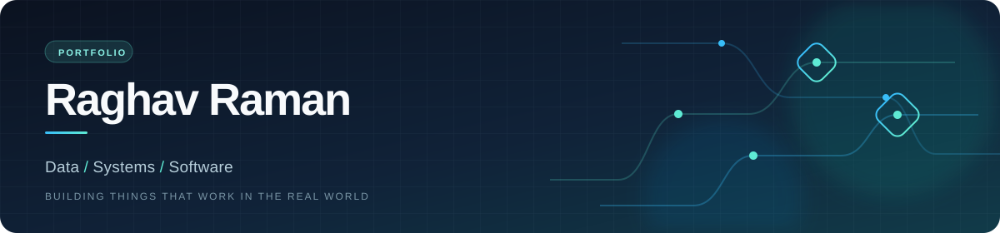

  <picture>
    <source media="(max-width: 640px)" srcset="./assets/profile-banner-mobile.svg" />
    
  </picture>

  <strong>Senior Software Engineer at Capgemini</strong> · ETL and data integration 
  Building dependable pipelines and tools that make complex data easier to use.

  &nbsp;
  &nbsp;
  

---

## About

I work on ETL and data integration, from keeping scheduled loads healthy to designing SCD Type 1/2, file-processing, and hierarchy-parsing pipelines. My day-to-day stack includes Informatica IICS/IDMC, PowerCenter, SSIS, Azure Synapse, Oracle, DB2, and SQL.

Outside work, I build browser-based tools, Python data utilities, and retrieval systems with FastAPI, Pydantic, RAG, and FAISS.

## Selected work

### ETLGuard

A Python data-quality toolkit for CSV, Excel and API feeds, with Pydantic validation, rejected-row reports, transactional MySQL loads, SCD Type 2 history and safe batch retries. The live browser demo runs the same validator through Pyodide.

Verified with **137 tests**, **91.19% coverage**, and all four Python 3.11/3.13 × MySQL 8.0/8.4 combinations.

Python · Pydantic · SQLAlchemy · MySQL · Pytest · Pyodide &nbsp;·&nbsp; [Source ↗](https://github.com/theraghavraman/etl-validation-toolkit) &nbsp;·&nbsp; [Live demo ↗](https://theraghavraman.github.io/etl-validation-toolkit/) &nbsp;·&nbsp; [v0.1.3 downloads ↗](https://github.com/theraghavraman/etl-validation-toolkit/releases/tag/v0.1.3)

### ReData

A browser-first analytics workspace powered by local DuckDB. It brings data from databases, S3, and REST APIs into staging tables with full, append, and upsert syncs.

JavaScript · Python · DuckDB · SQL &nbsp;·&nbsp; [Source ↗](https://github.com/theraghavraman/redata) &nbsp;·&nbsp; [Live app ↗](https://theraghavraman.github.io/redata/) &nbsp;·&nbsp; [DOI ↗](https://doi.org/10.5281/zenodo.23314956)

### CodeProof

A local-first code verification lab for static checks, sandboxed test runs, Python grammar checks, SBOM generation, and supply-chain audits.

JavaScript · TypeScript · Pyodide · GitHub Actions &nbsp;·&nbsp; [Source ↗](https://github.com/theraghavraman/codeproof) &nbsp;·&nbsp; [Live app ↗](https://theraghavraman.github.io/codeproof/)

### OmniConverter Studio

A private file and data toolkit for PDF, OCR, media, and format conversion in the browser, with optional local Python and desktop engines.

JavaScript · Python · Electron &nbsp;·&nbsp; [Source ↗](https://github.com/theraghavraman/omni_suite_light) &nbsp;·&nbsp; [Live app ↗](https://theraghavraman.github.io/omni_suite_light/)

### SPACE

An interactive observatory for exploring space-mission datasets. JavaScript &nbsp;·&nbsp; [Source ↗](https://github.com/theraghavraman/space) &nbsp;·&nbsp; [Live app ↗](https://theraghavraman.github.io/space/)

### Rust Atlas

A visual, concept-first guide to learning Rust. HTML · JavaScript &nbsp;·&nbsp; [Source ↗](https://github.com/theraghavraman/rustatlas) &nbsp;·&nbsp; [Live app ↗](https://theraghavraman.github.io/rustatlas/)

  
<strong>More things I've built</strong>

   
  <ul>
    <li><a href="https://theraghavraman.github.io/mindgames/">Mind Games</a> — Sudoku variants, logic puzzles, and brain games (<a href="https://github.com/theraghavraman/mindgames">source</a>)</li>
    <li><a href="https://theraghavraman.github.io/sandbox/">Redmark Forge Sandbox</a> — steganography and data encoding (<a href="https://github.com/theraghavraman/sandbox">source</a>)</li>
    <li><a href="https://theraghavraman.github.io/periodic_tabularasa/">TabulaRasa</a> — an interactive periodic table (<a href="https://github.com/theraghavraman/periodic_tabularasa">source</a>)</li>
    <li><a href="https://theraghavraman.github.io/philosophy-quote-visualizer/">PHILOGRAPH</a> — a philosophy quote visualizer (<a href="https://github.com/theraghavraman/philosophy-quote-visualizer">source</a>)</li>
    <li><a href="https://theraghavraman.github.io/princeofparadox/">Prince of Paradox</a> — a thought engine (<a href="https://github.com/theraghavraman/princeofparadox">source</a>)</li>
  </ul>

## Toolbox

<strong>Data engineering</strong>

<table width="100%">
  <tr>
    <td align="center" width="33%"> Informatica</td>
    <td align="center" width="33%"> SSIS</td>
    <td align="center" width="33%"> Synapse</td>
  </tr>
  <tr>
    <td align="center" width="33%"> Talend</td>
    <td align="center" width="33%"> Snowflake</td>
    <td align="center" width="33%"> Databricks</td>
  </tr>
  <tr>
    <td align="center" width="33%"> Kafka</td>
    <td align="center" width="33%"> DuckDB</td>
  </tr>
</table>

<strong>Databases</strong>

<table width="100%">
  <tr>
    <td align="center" width="33%"> Oracle</td>
    <td align="center" width="33%"> IBM DB2</td>
    <td align="center" width="33%"> SQL Server</td>
  </tr>
  <tr>
    <td align="center" width="33%"> PostgreSQL</td>
    <td align="center" width="33%"> MySQL</td>
  </tr>
</table>

<strong>Python & AI</strong>

<table width="100%">
  <tr>
    <td align="center" width="33%"> Python</td>
    <td align="center" width="33%"> FastAPI</td>
    <td align="center" width="33%"> Pydantic</td>
  </tr>
  <tr>
    <td align="center" width="33%"> LangChain</td>
    <td align="center" width="33%"> FAISS</td>
    <td align="center" width="33%"> Pytest</td>
  </tr>
</table>

<strong>Cloud & delivery</strong>

<table width="100%">
  <tr>
    <td align="center" width="33%"> AWS</td>
    <td align="center" width="33%"> Google Cloud</td>
    <td align="center" width="33%"> Docker</td>
  </tr>
  <tr>
    <td align="center" width="33%"> Git</td>
    <td align="center" width="33%"> Linux</td>
    <td align="center" width="33%"> Actions</td>
  </tr>
  <tr>
    <td align="center" width="33%"> ServiceNow</td>
  </tr>
</table>

## Credentials

- Oracle Cloud Infrastructure 2024 Generative AI Certified Professional · Informatica IDMC Foundation
- Databricks Generative AI Fundamentals · Google Advanced Data Analytics · AWS Cloud Quest: Cloud Practitioner
- Snowflake Data Warehousing Workshop · Confluent Fundamentals: Apache Kafka
